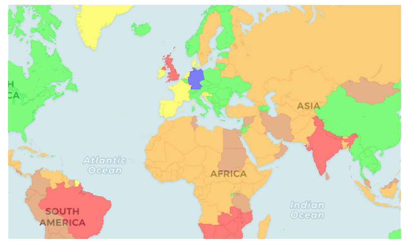
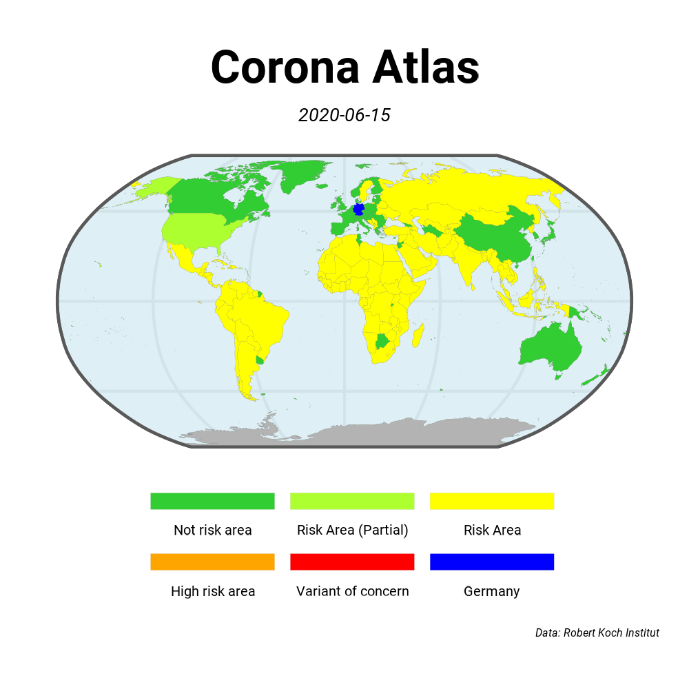

# Project discontinued

# Corona Atlas 

_Visit
[our website](https://dieghernan.github.io/corona-atlas.de/)
or contact us directly
[via mail](mailto:info@corona-atlas.de)._
   

Interactive map of the international COVID-19 risk areas as designated by the German authorities.

The site preserves historical data collected from the [Robert Koch Institute][rki].
It is no longer updated and does not provide current travel guidance.

The original scraper collected data using **Python** and
[**Scrapy**](https://scrapy.org/).
The scraper also uses
[**pandas**](https://pandas.pydata.org/) and
[**pycountry**](https://pypi.org/project/pycountry/).

The original **R** pipeline rendered the map with
[**rmarkdown**](https://rmarkdown.rstudio.com/),
[**leaflet**](http://rstudio.github.io/leaflet/),
[**giscoR**](https://dieghernan.github.io/giscoR/) and packages from the
[**tidyverse**](https://www.tidyverse.org/).
The website uses [**Chulapa**](https://dieghernan.github.io/chulapa/)
as its Jekyll theme.

## Additional resources

-   [RKI website][rki]: Data source.

[rki]: https://www.rki.de/DE/Content/InfAZ/N/Neuartiges_Coronavirus/Risikogebiete_neu.html

## Historical map

[][corona-atlas]

## Time-lapse

[corona-atlas]: https://dieghernan.github.io/corona-atlas.de/

## Site maintenance

See [the maintenance and social-card instructions](scripts/README.md) for local
builds, sharing images and the Pages workflow. The interactive map uses
OpenStreetMap and displays the historical risk designations.
